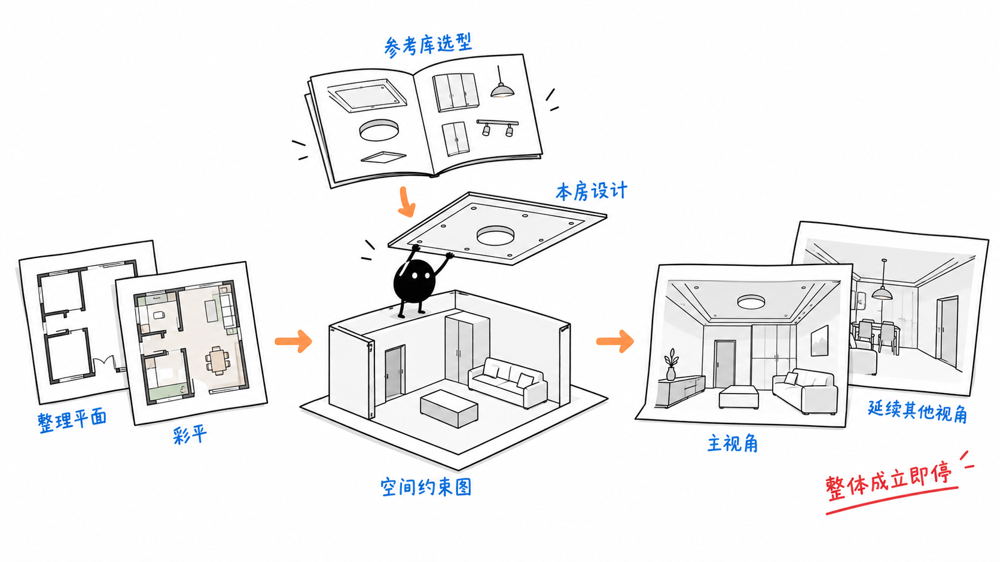
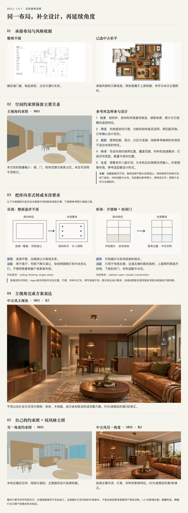

# 住宅平面转彩平与效果图

**当前正式版：v1.4.1 · MIT**

上传 CAD、PDF 或平面图片。AI 先整理平面，与你确认疑点，再制作彩平和室内效果图。

效果图帮助你评判风格、调整方案、直观看懂平面。目标是空间关系可信、布局逻辑成立、硬装衔接顺畅、软装合理、美观有氛围，整体像一个完成的方案。

可以完成全流程。也可以从已确认的整理平面或彩平继续。

[下载正式版](https://github.com/yangplato/cad-plan-to-room-render/releases/tag/v1.4.1) · [查看 Skill](SKILL.md) · [造型库使用说明](references/form-library/使用说明.md)

## 1.4.1 的重点

- **用约束图保留布局，用参考库补全设计。** 不要求先建成精细三维模型。家具体块只表示占位，吊顶、灯光和柜体形式由本房设计要求补全。
- **整体方案成立就交付。** 只修正影响空间理解、使用、明确要求或整体完成度的问题。合理细部差异可以保留；同方案同机位累计最多两轮必要修正，达到目的立即停止。
- **参考库随完整 ZIP 提供。** 内含63条造型、46个来源、观察文字、检索工具和浏览页。文字可离线使用；第三方照片在线引用，访问情况取决于实际网络。
- **多视角延续主要方案。** 每个角度使用自己的约束图和同风格主图，延续主要吊顶、灯光、柜体、材料与家具特征。

这套尺度用于效果图。原始资料识别、整理平面和彩平仍按各阶段规则检查。默认效果图供方案评判，不作为施工尺寸或构造复现依据；明确要求准确度测试时另定检查范围。



**布局可信，设计完整，可供评判。** 约束图保留主要空间关系；参考库和提示词补全设计。其他角度使用自己的约束图及同风格主图，延续主要方案。

图示是方法说明，不是本案模型或实际效果图。

### 用187㎡客厅看这条流程



上图使用已有实测成果补充流程说明。整理平面和彩平是承接依据；本次主视角实际传入空间约束图，参考照片经观察后转成设计文字，未作为附件。另一角度使用自己的约束图和同风格主图，延续主要方案。

展示的是代表版本，不是全部试验结果或逐图用户接受证明。实际范围见[验证说明](examples/validation.md)。

## 怎样开始

提供你已有的资料。说明要做哪些房间和风格。
不必先准备 JSON、三维模型或完整设计说明。

| 你提供什么 | AI 先做什么 |
|---|---|
| CAD 文件 | 检查能否读取，展示目标平面。有多套方案时，请你选择。 |
| 平面图片或 PDF | 检查图面是否完整、清晰，展示识别结果和疑点。 |
| 已确认的整理平面或彩平 | 核对文件和版本，从对应阶段继续。 |
| 只提及这个 Skill | 介绍流程，询问你有什么资料。 |
| 只询问功能 | 回答问题，不开始生图。 |

不能读取 DWG 时，AI 会说明原因，并请你提供清晰的 PNG、PDF 或可读的 DXF。
没有可靠尺寸时，AI 按图面比例处理，并说明这一限制。

调用示例：

```text
使用 $cad-plan-to-room-render 处理附件平面。
我需要中古风彩平，以及客厅和餐厅的效果图。
每一步在对话中给我看成果，确认后再继续。
生图前先给我看实际输入图和完整提示词。
```

## 按四步完成

| 步骤 | AI 给你看什么 | 你确认什么 |
|---|---|---|
| 01 识别原始资料 | 目标平面、识别结果和疑点 | 使用哪套方案，疑点实际表示什么。 |
| 02 整理平面 | 干净平面、房间编号和房间物品说明 | 布局和物品含义是否正确。 |
| 03 制作彩平 | 实际输入图、完整提示词，再展示彩平 | 家具、材料、风格和画面表现。 |
| 04 制作效果图 | 镜头建议、空间约束图、完整提示词，再展示效果图 | 当前方案是否适合，哪些设计需要调整。 |

每一步确认后，AI 再进入下一步。已确认的事实不重复询问。
多种风格分别确认。前一步的设计改变后，相关后续图需要重新检查。

完成后，AI 按风格展示彩平和效果图，并附各步实际输入和提示词。
图片和制作资料保存在同一案例文件夹。审阅和确认留在对话中。

### 只在对话中确认

AI 在当前对话直接展示图片、简短检查结果和当前问题。
你直接回复“通过”，或说明要改什么。
不需要打开审阅网页、填写表单或另存确认文件。

首次制作每种彩平或每个效果图角度前，AI 展示完整提示词。
实际发送的文字必须与你确认的文字一致。
输入图的作用必须写清，图片也必须实际传入生图工具。

效果图只修正影响方案理解、使用或风格判断的问题。合理细部差异可以保留。
改变风格、主要设计或制作范围时，AI 再向你确认。
只有你明确授权时，AI 才代你检查并继续后续步骤。
AI 自检通过不等于你已确认。

### 效果图先确定共同场景，再延续设计

> 当前分支为候选规则与案例复核，未发布新版本。原平面提供结构与功能依据；未锁定活动家具可按尺度、通行和使用需求合理调整。方案确定后各视角共用同一配置。

1. **确定镜头。** AI 按房间建议广角、近景或两者组合，由你选择。已指定时不重复问。
2. **确定共同场景。** AI 用整理平面核对结构与功能，按使用需求选定未锁定活动家具，记录全部相关物件，补齐必要形体。
3. **制作空间约束图。** 为各机位分配说明任务，从同一简模输出约束图。允许合理裁切，整组共同交代主要空间和使用关系。

空间约束图必须能直接查看。
AI 先核对这张图，再把它作为图片传入生图工具。
缺少对应镜头的空间约束图时，不直接生成效果图。

约束图保留墙门窗、柱梁、固定柜体范围、隔断门头位置、家具占位和机位。家具不是只画方块：坐面、靠背、独立边几、台面和器具须可辨；精细材质由AI完成。未确定的吊顶用平顶占位，不提前建灯具；已有确认设计继续沿用。

接着按 **参考库选型 → 本房设计要求 → 主视角效果图 → 同空间其他视角** 执行：

- 先看参考形式是否适合房间尺度、功能和结构，再看风格。未定客厅吊顶选边吊或整面悬浮平顶；卧室选平顶或局部边吊。
- 写清构件位置、轮廓、覆盖范围和连接。灯光另写照明对象、灯具类型、数量、相对位置及安装方式。
- 先读库内视觉特征，必要时看参考照片，再写入提示词。如实记录本轮是否看图、照片是否作为附件传入。
- 主视角经你确认或明确委托代检后，其他角度使用自己的约束图和同风格主图，延续主要设计。未入镜物件也预先纳入共同配置；主图改变形体或遮挡时先回写简模。

出图后做一次整体检查，达到方案评判目的就交付。只有必要问题才修正；同方案同机位累计最多两轮，达到目的立即停。两轮是上限，合理细节差异不触发返工。保留首图及全部修正。

### 哪些差异需要修正

| 情况 | 处理 |
| --- | --- |
| 门墙关系改变、通道堵塞、硬装穿插、违反明确要求，或画面明显残缺到无法判断方案 | 修正影响最大的部位。 |
| 未指定柜门小分格、木纹、褶皱和小摆件略变，空间及整体设计仍成立 | 可以交付；你明确指定的细节继续遵守。 |
| 沙发类型、色彩、装饰多少存在多个合理选择 | 给你看完整方案，由你评判和调整。 |

空间约束图是实现效果图的手段，粗模形态不需要完整复现。接受一张图不自动把每处纹理或摆件变成精确规格；主要灯具布置仍须跨视角一致。其他角度共用实际数量、位置、朝向、组合与主要款式一致的场景；可见数量差异须由遮挡或取景解释。

详细流程见 [用户引导与确认](references/user-journey.md)。

## 平面固定什么，风格改变什么

| 内容 | 依据和处理方式 |
|---|---|
| 墙、门窗、通道、固定设备 | 依据原始资料和你的确认。不能为取景删墙或改洞口。 |
| 物品类别和占用位置 | 整理平面说明“哪里有什么”。图中的方块不代表成品款式。 |
| 未锁定活动家具 | 设计阶段可按尺度、通行、操作与使用需求调整数量、款式和局部摆放；不能改已确认功能关系。 |
| 已指定的产品、数量或尺寸 | 按你的要求执行。 |
| 后续房间效果图 | 共用同一场景配置与已选主图；彩平继续提供材料与风格参考，不能反推布局。 |

没有特别说明的墙统一通高。彩平的剖切不改变真实墙高。
彩平保留统一浅灰墙体剖面和抽象挂衣柜表达。
缺少立面、吊顶或细节资料时，按参考选型和本房设计要求补全。补全尺寸属于设计选择，不当作原图已有事实。

## 提示词怎样组成

生图提示词按三个层级展开：

1. **整体任务。** 说明要做什么，以及每张输入图的作用。彩平调用固定母版。
2. **房间内容。** 按房间编号说明物品和已确认的布置关系。房间内部不再编号。
3. **风格要求。** 按本案实际物件提取有效风格要求，保留材料与造型信息，删除冲突条款。

使用包内 [固定彩平母版](references/color-plan.md) 和按本案提取的 [风格模块](references/style-modules.md)。
效果图继续使用这三个层级，并继承已确认的设计。

十种风格：当代新中式、宋式美学、奶油风、中古风、法式复古、现代简约、意式极简、意式轻奢、东南亚风格、北欧风格。

完整文字保存在 [风格模块](references/style-modules.md)，使用时不需要访问研究网站。
研究来源保存在 [维护附录](docs/style-research.md)。

## 参考图怎样使用

随包表现与构图参考共 30 张图片。每次只传当前步骤需要的图。

| 参考类型 | 数量 | 只参考什么 |
|---|---|---|
| 彩平表现图 | 10 张，保留原文件 | 材质表现、光影、留白和画幅。 |
| 摄影构图图 | 20 张，1024×576 | 广角景别、前中后景、视线和光影。 |

每种风格有一张空间广角和一张正向广角。来源见 [参考说明](references/image-references.md)。

彩平通常使用整理平面和一张彩平表现参考。
主视角效果图使用整理平面、已确认彩平和对应镜头的空间约束图。
同空间其他视角还使用本风格选定主图，只延续设计、材料与款式。
需要时，再加一张摄影参考。

参考图不决定本案布局，也不替代本案已确认的设计。
固定表现母版保持有效；风格文字按本案提取，参考图不能覆盖共同场景。
图片来源和用途见 [参考说明](references/image-references.md)。

### 随包造型库

造型库用于选择吊顶、护墙板、岛台、柜体和室内门的形式，与上述30张表现及构图参考分开使用。
完整ZIP包含63条造型、46个来源、分类与视觉观察数据、检索工具及[本地浏览页](references/form-library/index.html)。解压后即可使用，不需要另找库或配置路径；也保留已有独立库及显式外部库接入。

下载完整ZIP并解压后，在浏览器中打开 `references/form-library/index.html`。GitHub文件页展示HTML源码，不是可操作的浏览页。AI可运行 `python3 scripts/form_library.py search --category 吊顶 --room 客厅`。工具使用Python标准库，无代码工具时可直接读包内JSON。详情见[随包使用说明](references/form-library/使用说明.md)。

文字可离线检索，照片与出处通过原站链接查看。大陆访问受线路、站点和图片CDN影响，不能统一保证直连，也不能一概称需要VPN。图片打不开时仍可用已有观察文字选型。本包保留来源与署名，不包含第三方照片。
参考形式提供设计特征，原平面和本机位约束图仍决定布局。

## 安装和其他平台

### 支持 Skill 文件夹的平台

1. 下载正式版，解压得到 `cad-plan-to-room-render/`。
2. 将整个文件夹放入客户端支持的 Skill 目录。保留内部文件，不只复制 `SKILL.md`。
3. 重新加载 Skill，确认客户端能找到它，再开始使用。

已有同名文件夹时，先备份，再更新。
安装目录和调用方式由客户端决定。
本包采用 [Agent Skills 文件格式](https://agentskills.io/specification)。

### 豆包、Kimi、Work Buddy 等平台

将完整包交给该平台的 AI，要求它从 [跨平台入口](references/portability.md) 开始。
它先检查能否读取资料、查看图片、携带参考图生图和展示结果。
再按 [平台适配说明](references/adapter-contract.md) 对接实际可用工具。

本 Skill 提供流程、提示词和参考资料。目标平台负责调用模型和工具。
缺少必要能力时，AI 应说明缺项，并交付待执行资料。
写出本地图片路径不等于已把图片传给模型。

## 已验证范围

案例范围和测试结果见 [验证说明](examples/validation.md)。这些记录不证明所有户型和平台都能得到同样结果。

生图模型仍可能漏画、误画或改变空间。每张效果图生成后做一次整体检查，重点看偏差是否影响方案理解、使用和风格判断；合理细部差异不自动返工。
空间约束图帮助说明关系，不能保证模型一次画对。
本包尚未在豆包、Kimi、Work Buddy 完成全流程验证。

具体范围见 [验证说明](examples/validation.md) 和 [历史质量对照](references/quality-calibration.md)。

## 执行和维护文件

| 文件 | 用途 |
|---|---|
| [SKILL.md](SKILL.md) | AI 的执行入口。 |
| [用户引导](references/user-journey.md) | 四步成果、对话确认和方案评判。 |
| [跨平台入口](references/portability.md) | 能力检查、随包资料使用和宿主适配。 |
| [验证说明](examples/validation.md) | 实测范围、历史记录与尚未验证的能力。 |
| [平面整理](references/prepare-plan.md) | 识别原图，整理平面，确认疑点。 |
| [彩平母版](references/color-plan.md) | 生成彩平的固定要求。 |
| [空间与效果图方法](references/room-render.md) | 镜头、空间约束图、跨视角延续与停止条件。 |
| [造型参考到本房要求](references/form-library.md) | 选构件形式，写本房设计及灯光要求。 |
| [运行记录](references/run-record.md) | 保存实际输入、提示词和制作状态。确认仍留在对话中。 |
| [可选数据工具](references/scene-contract.md) | 读取 DXF、检查 JSON、回绘平面。普通图片任务不需要安装 CAD 依赖。 |

修改工具代码时，运行相关测试：

```bash
python3 -m unittest discover -s tests -v
```

合成测试数据只检查工具行为，不证明生图准确。
新增规则应对应一个实际问题。新增参考图应说明来源和用途。
制作记录应保存实际发送的提示词，不用后改的模板替代。

仓库根目录就是完整 Skill 文件夹。
本包不含客户 DWG、密钥或 DWG 转换器。
用户资料不自动上传到新的第三方平台。

[MIT 许可](LICENSE) · [图片及第三方来源说明](NOTICE.md)
