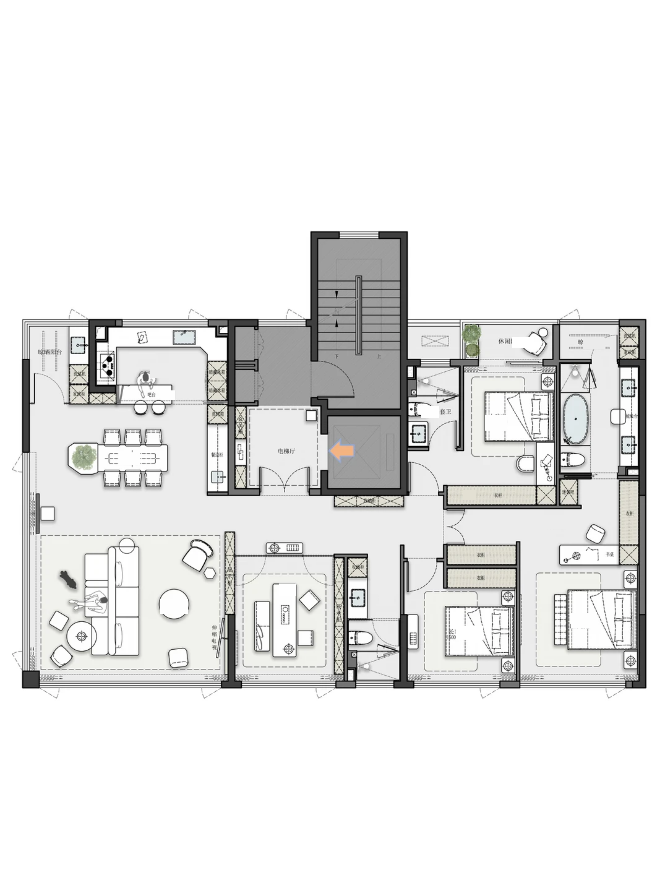
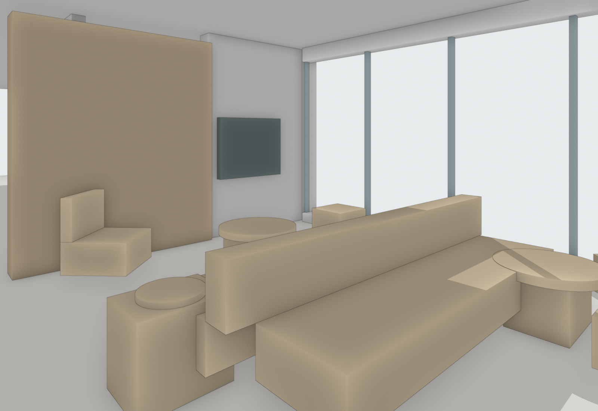
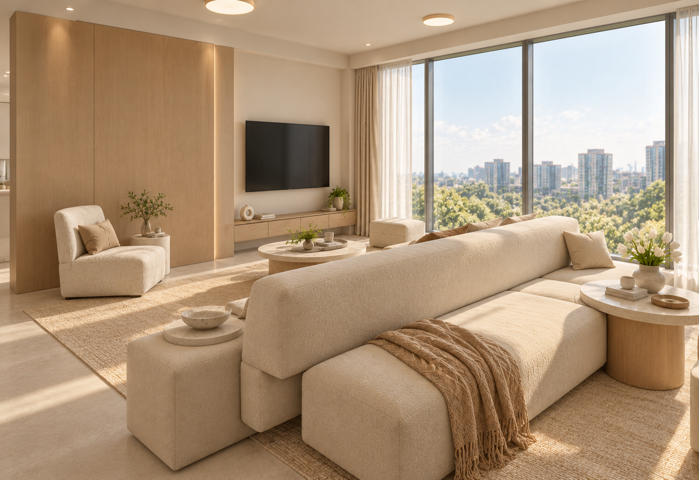
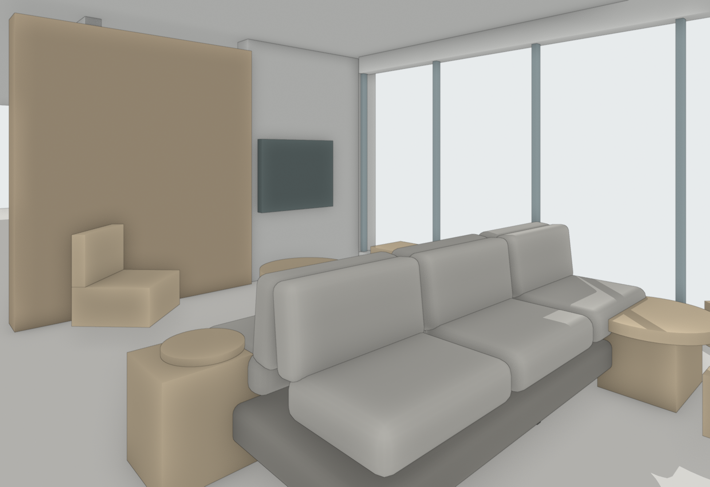
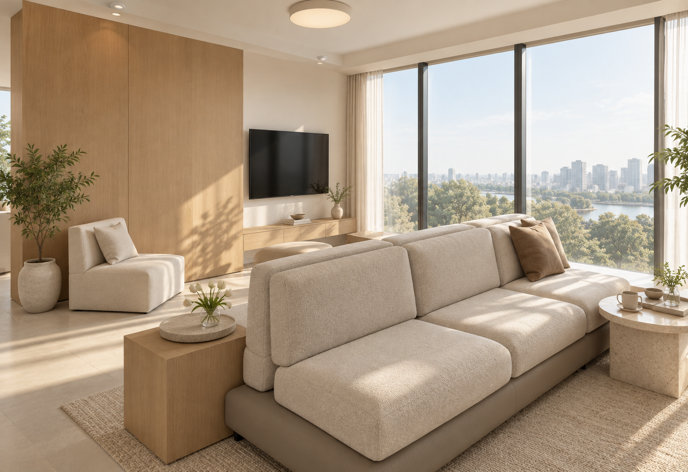
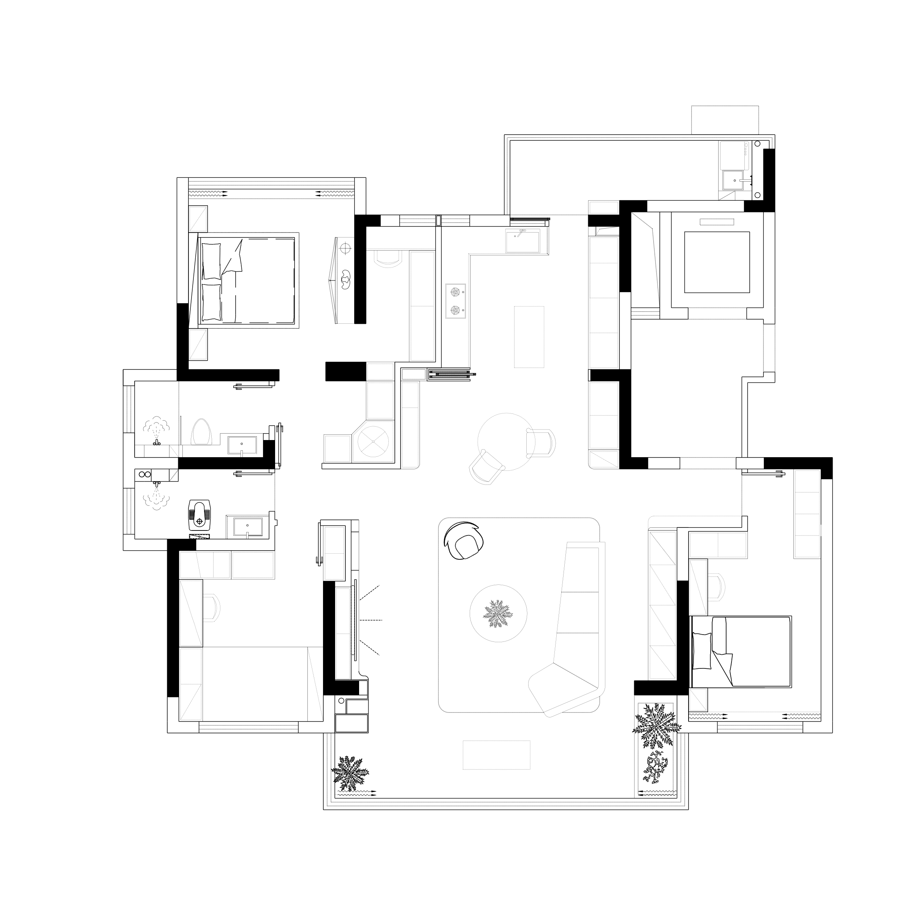
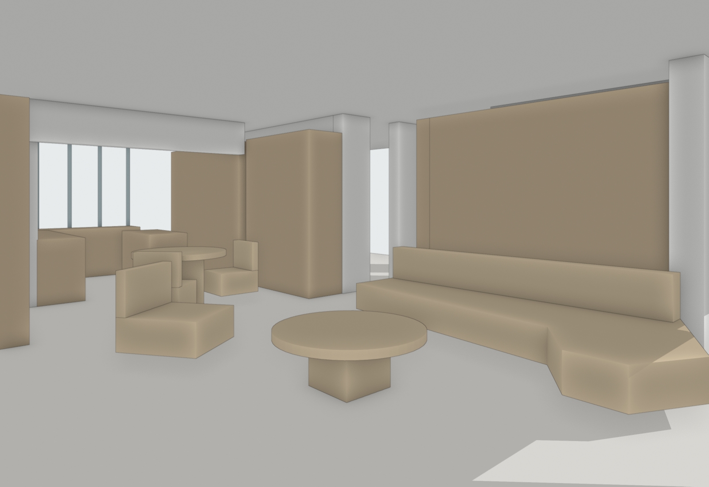
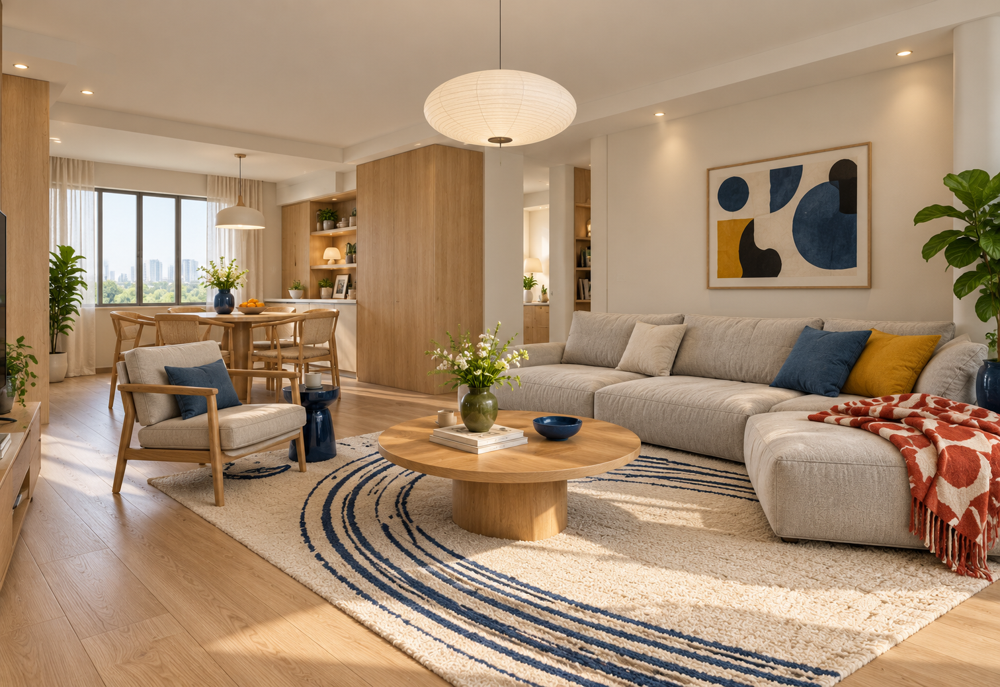
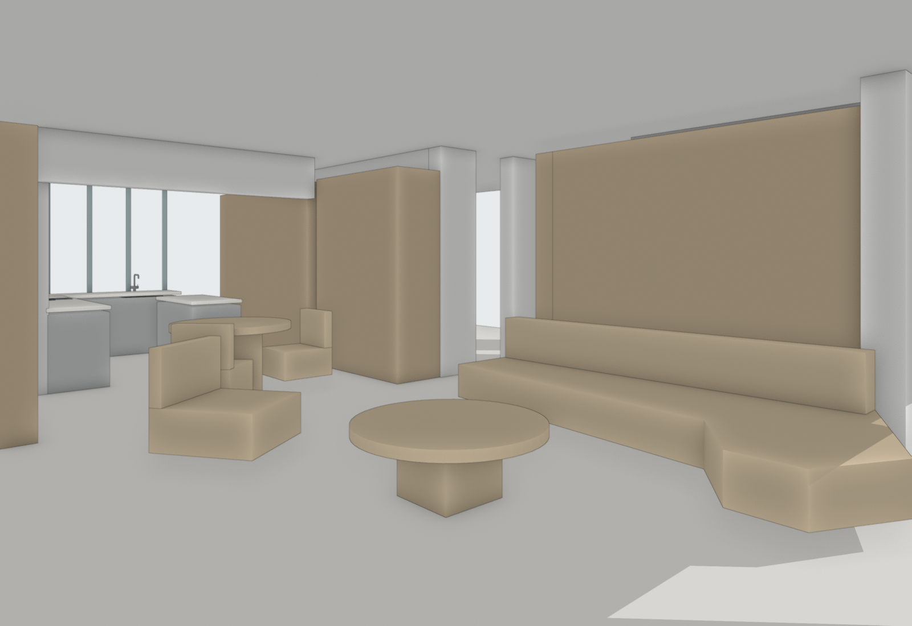
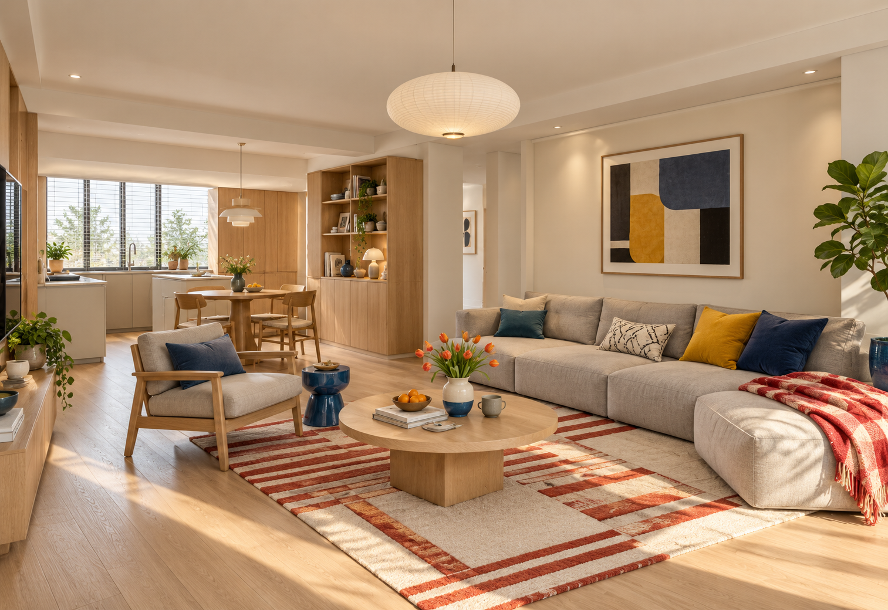

# P2 / D3：已有方案表达试验 · Pro 评审材料

**这是评审分支上的实验记录，不是正式 Skill 版本。** 目标是把已有平面方案表达清楚，用于风格判断和方案沟通。不是施工精度复现，也不是自动重新布置平面。

## 建议阅读顺序

1. [用户问题与 Agent 回应](对话与回应.md)。其中回应摘要与原文已分开标记。
2. 本页的新旧图像，以及两户型的整理后平面。
3. [完整审阅 HTML](布局复核/审阅.html)：下载仓库后用浏览器打开。保留全部六张首图、一次失败修正和两张新试验图。GitHub 文件页面不直接运行 HTML。
4. [新试验记录](布局复核/模型表达试验/试验记录.json)、[模型使用记录](布局复核/模型表达试验/模型使用记录.json)、[前一轮实际生图记录](布局复核/实际生图记录.json)。
5. [候选规则补丁](候选规则.patch)。只供评审，未应用到此分支的 Skill 文件。

## 请 Pro 独立判断

- 用户所指的沙发失真和厨房遗漏，分别从哪一步开始？请对照整理后平面、模型、约束图、提示词和效果图，不只根据本说明判断。
- 关键家具使用合理简模、固定构件表达功能特征，是否足以改善已有方案表达？哪些需要真实模型，哪些只需要简单形体？
- 哪些要求必须固定，哪些可由效果图补全？如何避免既机械复制体块，又随意改变布局？
- 哪些检查值得保留？哪些会造成反复修图，却不改善用户的方案判断？
- 现有证据是否支持删去彩平和整理图附件？若不支持，最小的进一步验证是什么？
- 候选规则补丁解决了什么，遗漏了什么？请指出不成立的前提，不必赞同 Agent 的结论。

## 来源与边界

- P2 的整理平面来自历史图片流程，不是已证实的 CAD 实体提取结果。
- D3 的整理平面来自历史 CAD 转换。本轮简模依据整理图描摹，没有重做 CAD 实体提取。
- 简模高度、部分构件尺寸和轮廓是设计假设。俯视叠合不是测量精度或施工验证。
- 新试验保留此前的平面、相机和风格，但同时改变模型细节、输入附件和提示词。它只能比较整套流程，不能单独归因于模型库。
- 每个新试验只有一张结果。未验证跨视角延续、跨户型稳定性或用户接受。
- 生图工具未提供可记录的模型精确版本、随机种子等参数。提示词和实际输入均留存，不能保证逐像素复现。
- 原提示词、脚本和记录保留当时的本机绝对路径作为证据。脚本不保证下载后直接运行。模型 `.blend` 可直接打开；修改脚本的 ROOT/LIB 等路径后才可尝试重跑。
- 仅上传本轮相关模型。D3 使用的三个库构件已包含在改进后的 `.blend` 中，没有上传整座本地模型库。

## 新旧结果

下表均是 Agent 自检，等待独立评审和用户判断。

| 对象 | 用户发现的问题 | 新试验改变 | 自检结果 | 仍未解决 |
|---|---|---|---|---|
| P2 客厅 M02 | 家具机械继承体块，沙发不符合常规 | 本案双面沙发简模，分开坐垫与靠背，减薄底座 | 座席层次更清楚 | 不是库内现成沙发；产品合理性、双面使用与审美尚未确认 |
| D3 客厅 M01 | 厨房功能遗漏，无清楚可辨台面 | 台面与柜体区分，导入水槽、龙头、灶具 | 台面和水槽龙头可辨 | 餐椅仍多画；厨房全部位置和构造未通过验证 |

D3 导入构件：`kitchen_fixture_sink_undermount_rectangular`、`kitchen_fixture_faucet_bent_tube_swivel`、`kitchen_fixture_cooktop_with_circular_inlet`。没有做真实台面开孔布尔，水槽表达仍有局限。

### P2：整理平面及新旧对照

**原空间约束图**

**原效果图**

**新空间约束图**

**新效果图**

### D3：整理平面及新旧对照

**原空间约束图**

**原效果图**

**新空间约束图**

**新效果图**

## 文件与复核

- `布局复核/生成核对简模.py`、`绘制平面叠合.py`：前一轮模型和叠合代码。
- `布局复核/模型表达试验/改进模型.py`：本轮两张试验的模型修改代码。
- 两阶段的实际提示词、模型、图像、调用记录保留在对应目录。
- `过程/生成空间约束图.py`：更早一轮的模型脚本，仅作过程背景，不是当前版本。
- `文件清单.json`：本包文件大小与 SHA-256。其完整性检查不等于视觉正确性检查。

本地 Skill 的三条候选规则和本轮建议要分开看。本轮模型库建议尚未写成正式规则。没有修改版本号、发布包或 Release。
