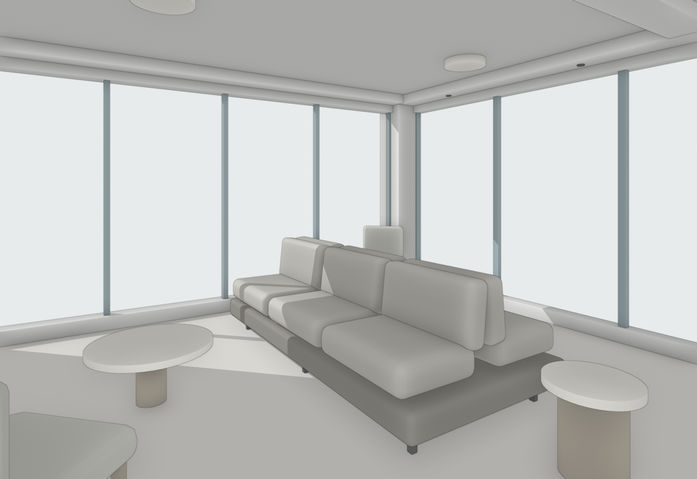
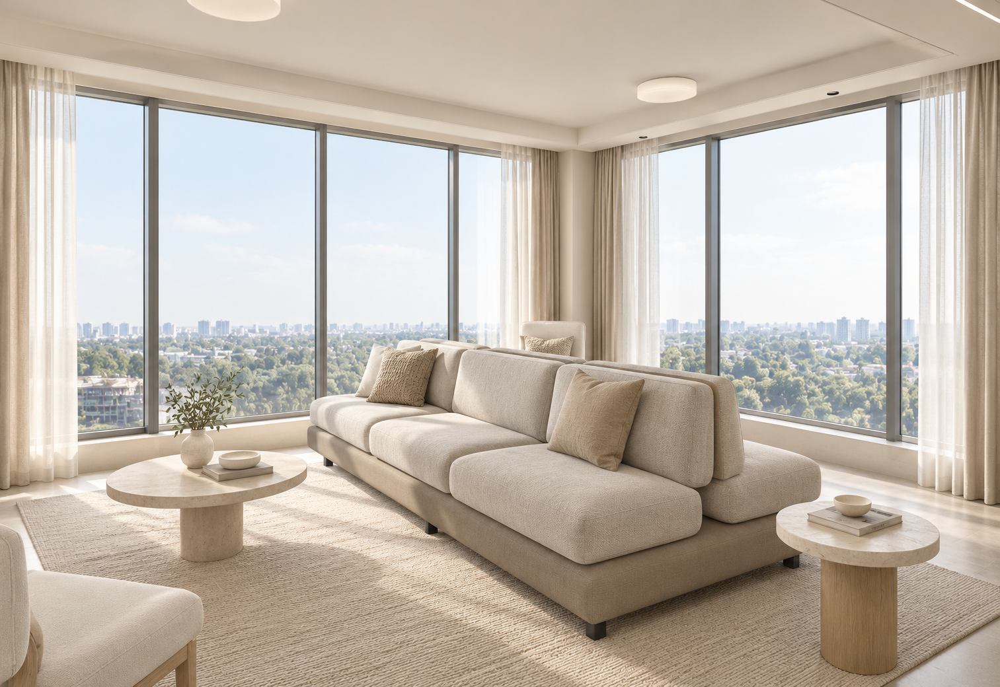
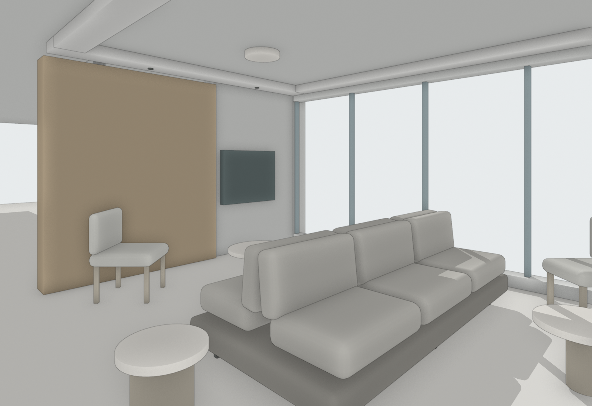
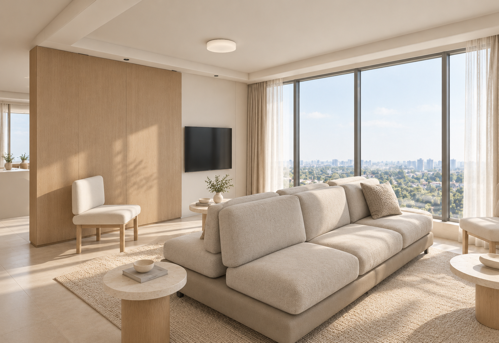
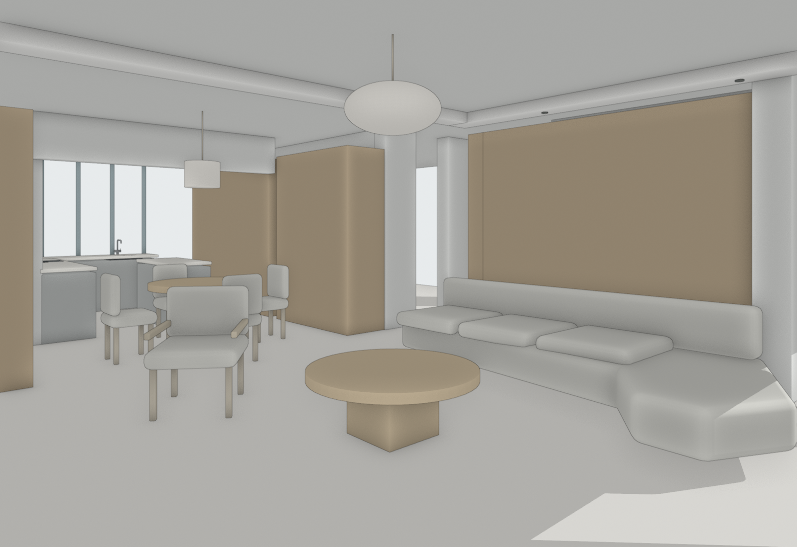
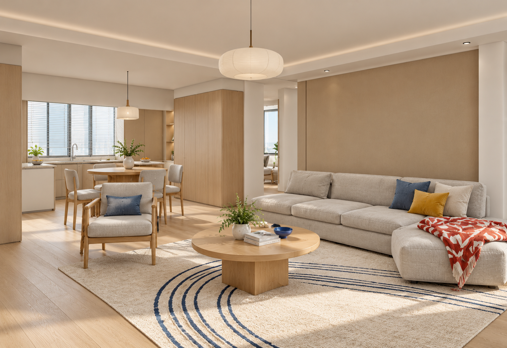
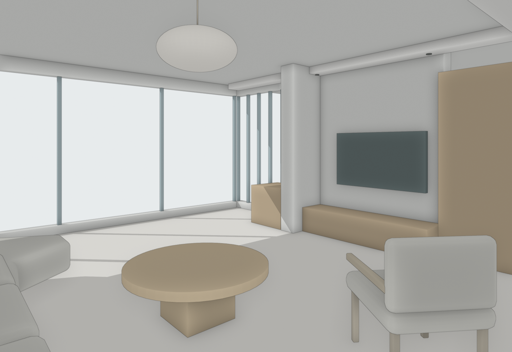
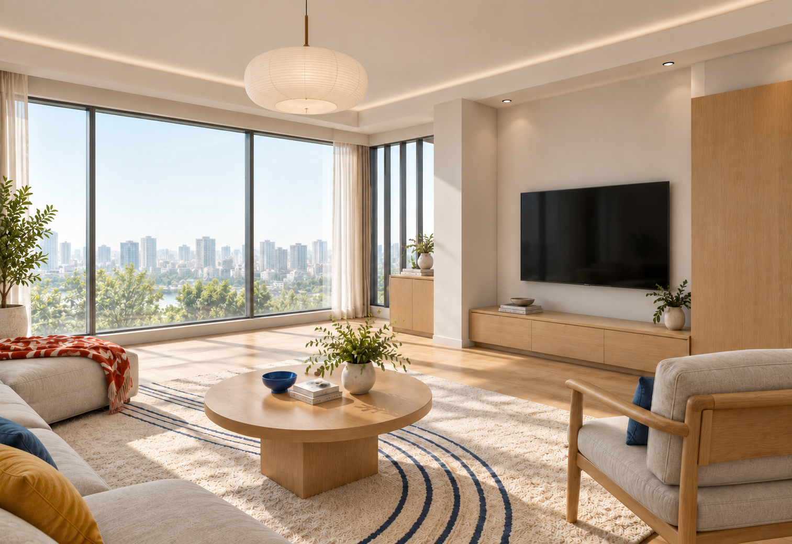

# 共同场景规则修订与 P2 / D3 双视角复核

本轮为候选改动。正式版本号、安装目录、main 与 Release 未替换。用户明确委托完成设计与生成，以下均为 Agent 自检，不等于用户接受。

## 实际改动

- 原平面固定结构、设备、已确认功能分区和使用关系。未锁定活动家具可在设计阶段合理调整；方案确定后各机位共用实际数量、位置、朝向、组合和主要款式一致的配置。
- 规则已覆盖 SKILL、房间流程、彩平提示词、风格提取、参考输入、整理阶段边界、场景记录、平台适配及用户引导。不是增加餐椅例外。
- 旧资料整理仍如实保留源图；设计调整另记，不能把改方案称为无损清理。
- 简模先与整理平面叠合，彩平仅提供材料与风格。P2本轮提取彩平配色为文字；D3本轮实际传入彩平。未制定全局删附件规则。
- 模型只补关键识别和遮挡形体。P2复用已有双面沙发简模；D3复用既有厨房器具。没有扩建模型库。
- 主图补全后回写共用模型。D3第一次只改灯罩尺寸仍不够，第二角度变成直筒；已改简模为扁椭圆，再生成。随后局部去掉多画筒灯，累计两轮后停止。

## 依次检查

| 检查层 | P2 奶油风 | D3 现代北欧 |
|---|---|---|
| 空间与功能 | 双窗、电视隔断、相邻茶室与双面使用关系保留 | 主图交代客餐厨，反向交代电视墙与阳台；厨房台面和龙头可辨 |
| 主要物件合理性 | 两侧坐面、共同靠背、独立边几可辨；修复相交桌体 | 四席圆桌按本案设计确定；柜、台面、岛台、器具在模型分开 |
| 同方案一致性 | 两角度延续同一沙发、两椅和三几；差异可由遮挡说明 | 主要家具延续；纸灯罩修复；M02筒灯按可见两只保留 |
| 视觉表现 | 奶白、燕麦、浅木和自然光连续 | 浅木、浅灰、蓝黄和红白织物连续，景别互补 |

**残留与未验证：** D3岛台下柜和灶具部分遮挡，不算完整通过；通道按历史比例检查，未做动态拉椅与人体工学实测；P2双面沙发不是经核验的商品型号。两组结果不能证明跨户型稳定性。未指定纹理、褶皱和小摆件差异不继续修图。

## 图像与记录

### P2

**M01 约束图与效果图**

**M02 约束图与效果图**

### D3

**M01 约束图与效果图**

**M02 约束图与效果图**

主图实际生成输入为v1约束图。这里展示的是回写后用于共同场景复核的图，不把它冒充主图最初输入。实际输入、哈希、完整提示词与全部首图/失败结果见[案例续接记录](案例续接记录.json)。每个机位的生成轮次有独立记录。

## 规则检查

18项现有工具测试运行完成，17项通过、1项因可选依赖缺失跳过；这是工具回归，不证明生成图正确。两机位几何摘要一致，相机在主图回写前后未变。人工检查覆盖六类规则情形，详见记录。旧材料“D3多于两椅即错”的判定已撤回，历史原文保留。

本轮四张首图加两张必要修正，共六张生成结果。P2两个机位和D3主图均未修正。D3第二机位累计修正两轮，停止继续生图。
